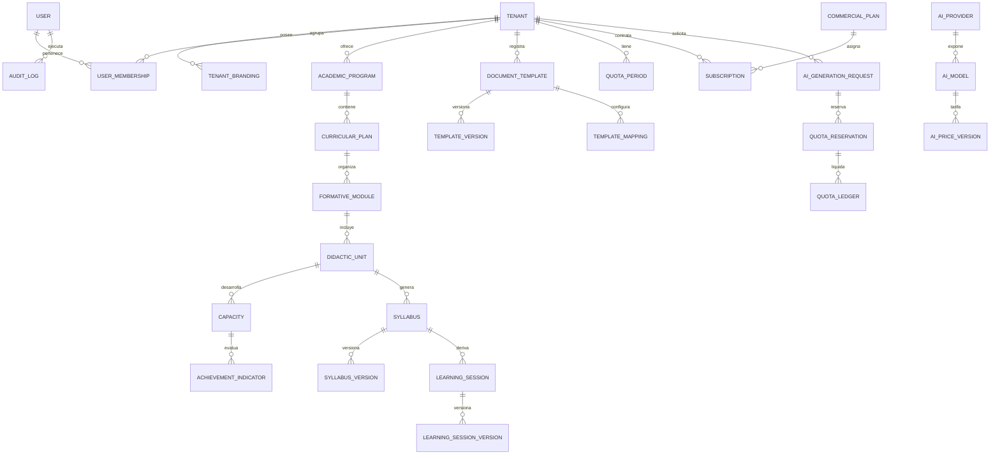

# Modelo de Datos MySQL: DocenteIA

## 1. Principios de Persistencia y Estándares
- **Motor:** MySQL 8.0+ / 8.4 LTS, `InnoDB`, charset `utf8mb4`, collation `utf8mb4_unicode_ci`.
- **Claves Primarias:** UUID v4 / CUID string `VARCHAR(36)` o `VARCHAR(30)` para portabilidad sin colisiones.
- **Aislamiento Multi-Tenant:** `tenant_id` obligatorio y no nulo en todas las entidades institucionales. Índices compuestos `(tenant_id, ...)` en todas las búsquedas frecuentes.
- **Auditoría Estándar:** `created_at`, `updated_at`, y cuando proceda `created_by`, `updated_by`.
- **Moneda y Finanzas:** Tipo `DECIMAL(10, 4)` o `DECIMAL(12, 4)`. Prohibido el uso de `FLOAT` o `DOUBLE` para costos o créditos.
- **Ledger Inmutable:** `quota_ledger` es una tabla append-only; nunca se actualizan ni eliminan registros de consumo.

---

## 2. Mapa de Dominios de Entidades

---

## 3. Tablas Principales por Dominio

### 3.1 Plataforma, Autenticación y Multi-Tenancy
1. **`users`**: Identidad global del usuario (`id`, `email`, `password_hash`, `full_name`, `avatar_url`, `mfa_enabled`, `mfa_secret`, `is_superadmin`, `status`, `created_at`, `updated_at`).
2. **`tenants`**: Instituciones educativas (`id`, `slug`, `full_name`, `short_name`, `institutional_code`, `management_type`, `region`, `province`, `district`, `status`, `created_at`, `updated_at`).
3. **`tenant_branding`**: White-label institucional (`id`, `tenant_id`, `primary_color`, `secondary_color`, `accent_color`, `surface_color`, `text_color`, `logo_url`, `favicon_url`, `login_banner_url`, `welcome_title`, `welcome_subtitle`, `footer_text`, `border_radius`, `font_family`).
4. **`tenant_domains`**: Dominios y subdominios asignados (`id`, `tenant_id`, `hostname`, `is_primary`, `is_verified`, `ssl_status`).
5. **`tenant_memberships`**: Vínculo usuario-institución con rol RBAC (`id`, `tenant_id`, `user_id`, `role`, `status`, `created_at`). Roles: `TENANT_ADMIN`, `ACADEMIC_COORDINATOR`, `PROGRAM_DIRECTOR`, `TEACHER`, `ACADEMIC_REVIEWER`, `TENANT_AUDITOR`.
6. **`audit_logs`**: Trazabilidad completa (`id`, `tenant_id`, `user_id`, `action`, `entity_type`, `entity_id`, `payload_before`, `payload_after`, `ip_address`, `user_agent`, `created_at`).

### 3.2 Planes Comerciales, Cuotas y Ledger
7. **`commercial_plans`**: Catálogo de planes configurables (`id`, `code`, `name`, `description`, `price_monthly`, `price_yearly`, `currency`, `max_teachers`, `max_syllabi_per_period`, `max_sessions_per_period`, `max_storage_mb`, `ai_credit_quota`, `features_json`, `status`).
8. **`subscriptions`**: Suscripción activa del instituto (`id`, `tenant_id`, `plan_id`, `status`, `starts_at`, `ends_at`, `auto_renew`).
9. **`quota_periods`**: Periodos de consumo contable por tenant (`id`, `tenant_id`, `period_start`, `period_end`, `allocated_credits`, `used_credits`, `is_closed`).
10. **`quota_reservations`**: Bloqueo atómico preventivo para evitar sobregiro (`id`, `tenant_id`, `user_id`, `request_id`, `estimated_credits`, `status`, `created_at`, `expires_at`).
11. **`quota_ledger`**: Libro mayor append-only de consumo real (`id`, `tenant_id`, `user_id`, `reservation_id`, `request_id`, `event_type`, `credits_delta`, `tokens_input`, `tokens_output`, `provider_cost_usd`, `balance_after`, `created_at`).

### 3.3 Catálogo Académico Curricular (Normativa MINEDU)
12. **`academic_programs`**: Carreras / Programas de estudios (`id`, `tenant_id`, `code`, `name`, `degree_level`, `status`).
13. **`curricular_plans`**: Planes de estudio aprobados (`id`, `tenant_id`, `program_id`, `code`, `resolution_number`, `validity_year`, `status`).
14. **`formative_modules`**: Módulos formativos del plan (`id`, `tenant_id`, `plan_id`, `code`, `name`, `order_index`).
15. **`didactic_units`**: Unidades didácticas (asignaturas) (`id`, `tenant_id`, `module_id`, `code`, `name`, `academic_term`, `cycle`, `theoretical_hours`, `practical_hours`, `total_hours`, `credits`).
16. **`capacities`**: Capacidades formativas oficiales (`id`, `tenant_id`, `unit_id`, `code`, `description`, `order_index`).
17. **`achievement_indicators`**: Indicadores de logro evaluables (`id`, `tenant_id`, `capacity_id`, `code`, `description`, `order_index`).
18. **`teacher_assignments`**: Asignaciones docentes (`id`, `tenant_id`, `user_id`, `unit_id`, `academic_year`, `academic_period`).
19. **`academic_source_documents`**: Archivos oficiales subidos (`id`, `tenant_id`, `program_id`, `file_name`, `file_url`, `file_size`, `mime_type`, `sha256_hash`, `status`).

### 3.4 Motor de Plantillas OOXML
20. **`document_templates`**: Modelos institucionales (`id`, `tenant_id`, `template_type`, `name`, `description`, `status`). Tipos: `SYLLABUS`, `LEARNING_SESSION`, `BATCH_SESSIONS`, `RUBRIC`.
21. **`document_template_versions`**: Versiones de archivo DOCX (`id`, `template_id`, `version_number`, `file_url`, `sha256_hash`, `is_active`, `created_at`).
22. **`document_template_mappings`**: Mapeo semántico de placeholders y tablas (`id`, `version_id`, `field_key`, `marker_syntax`, `source_path`, `is_repeatable`, `repeat_key`).

### 3.5 Generación de Documentos y Entregables
23. **`syllabi`**: Contenedor del sílabo (`id`, `tenant_id`, `unit_id`, `teacher_id`, `template_version_id`, `status`). Estados: `DRAFT`, `GENERATED`, `IN_REVIEW`, `APPROVED`, `ARCHIVED`.
24. **`syllabus_versions`**: Contenido estructurado JSON del sílabo (`id`, `syllabus_id`, `version_number`, `general_info_json`, `presentation_text`, `competencies_json`, `weekly_plan_json`, `evaluation_strategy_json`, `resources_json`, `bibliography_json`, `is_approved`, `docx_file_url`, `pdf_file_url`).
25. **`learning_sessions`**: Sesiones de aprendizaje generadas (`id`, `tenant_id`, `syllabus_id`, `unit_id`, `teacher_id`, `session_number`, `topic`, `duration_minutes`, `status`).
26. **`learning_session_versions`**: Contenido estructurado JSON de la sesión (`id`, `session_id`, `version_number`, `pedagogical_moments_json`, `activities_json`, `evaluation_json`, `docx_file_url`, `pdf_file_url`).
27. **`document_reviews`**: Historial de observaciones y aprobaciones (`id`, `tenant_id`, `document_type`, `document_id`, `reviewer_id`, `status`, `observations`, `reviewed_at`).

### 3.6 Infraestructura de IA y Trabajos
28. **`ai_providers`**: Catálogo de proveedores (`id`, `code`, `name`, `adapter_type`, `is_active`).
29. **`ai_models`**: Modelos registrados (`id`, `provider_id`, `model_code`, `display_name`, `tier`, `max_context_tokens`, `supports_structured_output`, `is_active`).
30. **`ai_generation_requests`**: Registro detallado de cada invocación (`id`, `tenant_id`, `user_id`, `intent`, `model_id`, `status`, `input_tokens`, `output_tokens`, `cost_usd`, `idempotency_key`, `error_message`, `created_at`).
31. **`job_executions`**: Trazabilidad de jobs BullMQ (`id`, `tenant_id`, `job_type`, `status`, `progress_percent`, `result_json`, `error_message`, `created_at`, `completed_at`).

---

## 4. Estrategia de Migraciones y Semillas (Seed)
- Las migraciones se gestionarán mediante `prisma migrate dev` para desarrollo y `prisma migrate deploy` en entornos de prueba / producción.
- El archivo de seed creará:
  1. Un usuario `PLATFORM_SUPERADMIN` inicial seguro.
  2. Planes comerciales por defecto (`BÁSICO`, `PROFESIONAL`, `INSTITUCIONAL`).
  3. Proveedores de IA (`OpenAI`, `Google Gemini`, `Groq`, `Ollama`).
  4. Dos institutos de prueba completos con sus sedes, temas, directores, docentes, unidades didácticas y plantillas oficiales.
